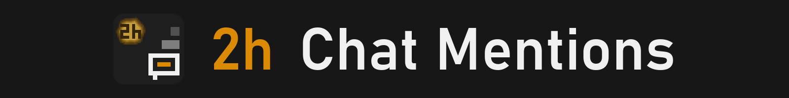
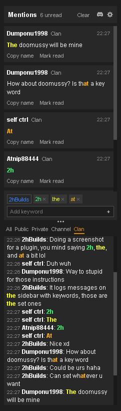

Catch up after being away: every chat line that names you or a keyword becomes a card.

<table width="100%">
<tr>
<td valign="top">

  

## How it works

1. **Add a keyword** under the cards. Your name is one already.
2. **A line with a keyword becomes a card.** Click it to jump to the line in the kept chat.
3. **Click a keyword** to pick its colour.

 

## In the picture

1. **The cards, at the top.** Each clan line that held a keyword, newest first, with who said it and when. A click jumps to the line in the chat below.
2. **The keywords, in the middle.** The name **2hBuilds** (blue, always a keyword) and three set keywords: **2h** in green, **the** in yellow and **at** in orange. Click one to change its colour.
3. **The kept chat, at the bottom.** The Clan tab selected, every keyword in its own colour. Whole words only is off here, so **at** is also coloured inside *that* and *whatever*.

 

## Good to know

- **Cleared when RuneLite closes.** The cards and the kept chat are never saved to a file. They last through logouts and world hops, and are gone when you close RuneLite. Your keywords, colours and settings stay.
- **It only reads the chat.** It never types or sends anything, and nothing leaves your computer.
- **Cards come from other players.** Your own lines and the game's messages never make one.
- **Leaves out what your chatbox hides.** Autochat trade adverts (with Public on), and anything RuneLite's Chat Filter hides, never become cards, even with the chatbox minimized.
- **The cards follow the selected tab.** On Clan you see only Clan cards; All shows every card. A Public line still makes its card, waiting under Public and All.
- **The settings menu** (the icon at the top right): which chats to keep (Game and Trade are off at first), whole words only, and how many cards and lines to keep for each chat (1,000 and 3,000 at first).

</td>
<td width="28"></td>
<td width="242" valign="top"> </td>
</tr>
</table>

---

<strong>Found a bug or have an idea?</strong> <a href="https://discord.gg/nsam4CfWzf">2hBuilds Discord</a>

Every setting and rule explained: <a href="https://github.com/2hBuilds/chat-mentions/blob/main/DETAILS.md">full details</a>.
