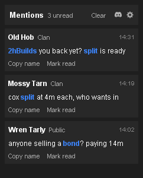
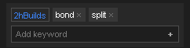
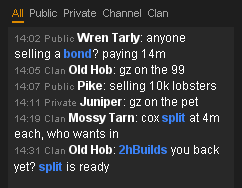

Catch up after being away: every chat line that names you or a keyword becomes a card.

<table width="100%">
<tr>
<td valign="top">

   

## How it works

1. **Add a keyword** under the cards. Your name is one already.
2. **A line with a keyword becomes a card.** Click it to jump to the line in the kept chat.
3. **Click a keyword** to pick its colour.

</td>
<td width="28"></td>
<td width="235" valign="top">   </td>
</tr>
</table>

<table width="100%">
<tr>
<td valign="top">

 

## Good to know

- **Memory only.** Nothing is written to disk or sent anywhere, and nothing is typed into the chat.
- **The game's own tabs.** Public, Private, Channel, Clan, and Game and Trade if you want them, 3,000 lines each.
- **The settings icon:** which chats to keep, whole words only, how many cards and lines.

</td>
<td width="28"></td>
<td width="235" valign="top"> </td>
</tr>
</table>

---

<strong>Found a bug or have an idea?</strong> Join the <a href="https://discord.gg/nsam4CfWzf">2hBuilds Discord</a>.

Every setting and rule explained: <a href="https://github.com/2hBuilds/chat-mentions/blob/main/DETAILS.md">full details</a>.
